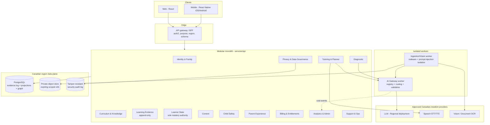
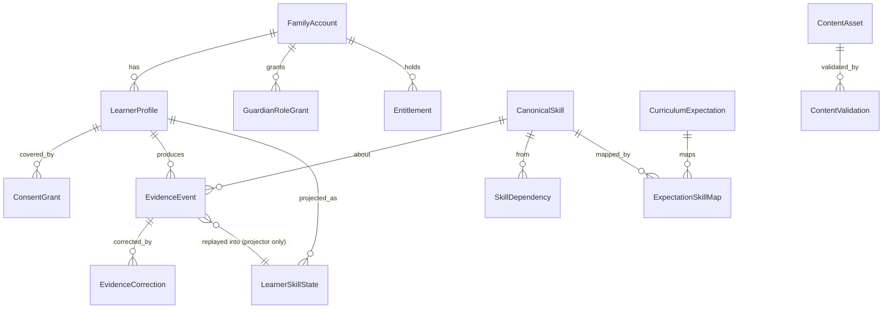
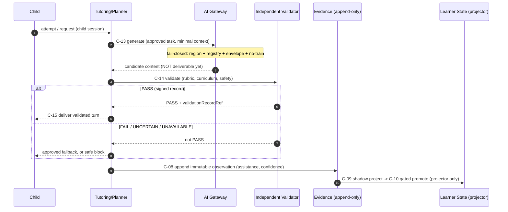
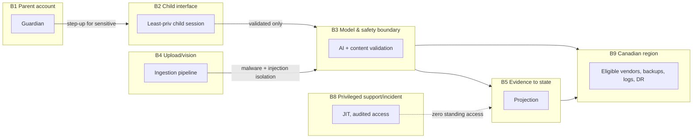
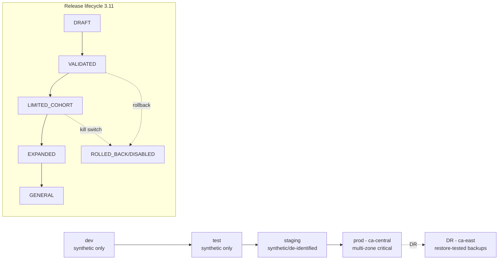

# Potenova Architecture Overview (WP-00)

Technology-neutral invariants come from the v2 baseline; the technology choices are in the
[ADRs](../adr/README.md). Diagrams are Mermaid (diagram-as-code, versioned with the repo).

## 1. Logical component architecture

A **modular monolith** (ADR-0001): one deployable hosting the bounded-domain modules, plus two
isolated workers for the bursty/risky paths (AI routing, media ingestion). Clients share the
`@potenova/contracts` types.

**Key rule shown:** child-facing requests reach a provider **only** via the AI Gateway, which
enforces registry + region + envelope before any call, and content is validated before delivery.

## 2. Domain ownership and canonical entities (ER)

Only **Learner State** may author mastery. Evidence is immutable; state is a projection.

Ownership boundaries (authoritative owner in parentheses): FamilyAccount/Guardian/Learner
identity (Identity & Family) · ConsentGrant/DataSubjectRequest (Privacy) · Curriculum graph
(Curriculum) · EvidenceEvent/Correction (Learning Evidence) · LearnerSkillState/Misconception
(Learner State) · ContentAsset/Validation (Content) · ModelRegistryEntry/AIInvocation (AI
Governance/Orchestration) · Entitlement/PurchaseTransaction (Billing) · SafetyCase (Child
Safety). Billing and learning histories join only through authorization-controlled aliases, and
every foreign reference enforces the Canadian region boundary.

## 3. Tutor-turn flow — generate → validate → deliver (AI-001)

The tutor **never** writes mastery. It submits evidence; the projector advances state by replay
under a policy version (`mastery-authority`).

## 4. Trust boundaries (B1–B11)

Full boundary set: B1 parent→family/roles · B2 child→protected learning APIs · B3 child
content→model/safety · B4 uploads→ingestion/vision · B5 evidence→projected state · B6
learning/identity→operational aggregates · B7 purchase channels→entitlement · B8 production
child data→privileged access · B9 Canadian region→eligible vendors/backups/logs/DR · B10 code
release→prod policy/model/content · B11 future B2B context→family context (isolated by default).

## 5. Deployment environments and release flow

Four strongly separated environments (SEC-002), region-pinned to Canada; staged rollout with
flags and kill switches (OPS-003; state machine 3.11).

Only `prod` may hold real child data; non-prod uses synthetic fixtures (`config` enforces this).
Highest-criticality services (identity, safety, consent, evidence integrity, AI validation) run
multi-zone; DR is a second Canadian region (active-active not required at launch).
